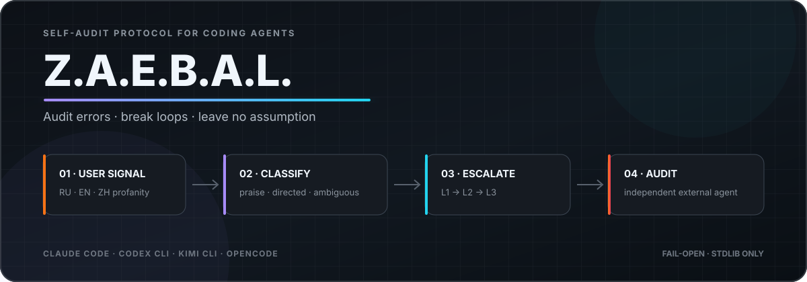

<div align="center">



<h3>
<strong>Z</strong>aebal? · <strong>A</strong>udit · <strong>E</strong>rrors ·
<strong>B</strong>reak · <strong>A</strong>nalyze · <strong>L</strong>eave no assumption
</h3>

<p>
<strong>Read this in other languages</strong><br>
<a href="README.md">🇺🇸 English</a> ·
<a href="README.ru.md">🇷🇺 Русский</a> ·
<a href="README.zh-CN.md">🇨🇳 简体中文</a>
</p>

<p>


</p>

<p>
<strong>Profanity-triggered self-audit for coding agents.</strong><br>
Z.A.E.B.A.L. treats user frustration as an operational signal: stop, re-check the
agent's assumptions, and escalate repeated failures to an independent auditor.
</p>

<p>
<a href="#capability-map">Capabilities</a> ·
<a href="#how-it-works">How it works</a> ·
<a href="#install">Install</a> ·
<a href="#configuration">Configuration</a> ·
<a href="#architecture">Architecture</a>
</p>

</div>

---

## Why it exists

When a coding agent gets stuck, it often repeats the same action with small variations
because one underlying belief about the task or codebase is wrong. The agent still treats
that belief as a fact, so another self-check can reproduce the same mistake.

Z.A.E.B.A.L. adds a feedback loop to the user-message boundary:

- profanity and direct complaints become an audit signal;
- positive profanity such as “fucking great” is silent and does not add to the streak,
  but does not authorize resuming a level-3/4 mutation stop;
- repeated signals escalate from a local protocol to a full stop;
- at level 3, the hook attempts a technically read-only external audit;
- at level 3, mutations resume only after an explicit user acknowledgment.
- at level 4, the agent asks permission for a 5–7-reviewer Swarm Review before
  launching any team or external auditor; repairs retain their own scope limits.

The audit challenges the agent's interpretation; it does not freeze a task contract.
It asks for a fact that could disprove the explanation, the next action that changes,
and a check of the actual reported failure. A repeated symptom calls for checking the
previous audit even without new profanity or after the streak resets/expires.
Continuation is permission to proceed, not proof of a fix. See the
[anonymized recovery examples](skills/zaebal/references/recovery-examples.md).

The current release does **not** install a technical tool lock. The protocol changes the
agent's instructions and asks it to stop; the human always retains the final control.

### Mutation-lock feasibility

Research completed on 2026-07-31 shows that a blocking mutation STOP is technically
possible on all four adapters, but with different guarantees:

| Host | Blocking surface | Feasibility and caveat |
|---|---|---|
| Claude Code | [`PreToolUse`](https://code.claude.com/docs/en/hooks) can deny `Bash`, edit/write tools, and MCP calls. | **Yes.** Exit `2` or a structured `deny` blocks before execution; hook configuration still remains under host/user control. |
| Codex | [`PreToolUse`](https://learn.chatgpt.com/docs/hooks.md) can deny Bash, `apply_patch`, MCP, and local function tools. | **Yes, broad coverage.** Tool-coverage exceptions mean it is a guardrail rather than an absolute sandbox. |
| Kimi CLI | [`PreToolUse`](https://www.kimi.com/code/docs/en/kimi-code-cli/customization/hooks.html) blocks with exit `2` or structured `deny`. | **Yes, fail-open.** A hook error, crash, or timeout allows the operation. |
| OpenCode | [`tool.execute.before`](https://opencode.ai/docs/plugins/) can reject a tool call; [`permission`](https://opencode.ai/docs/permissions/) can deny edit and shell actions. | **Yes.** A durable lock should combine protocol state with host permissions instead of relying only on a plugin exception. |

No lock or state machine is added yet. The text fixes and incident telemetry should first
show whether a discipline-based STOP remains insufficient.

## Capability map

| Capability | What it does | Implementation |
|---|---|---|
| Multilingual detection | Detects Russian, English, and Chinese profanity, including punctuation-separated and common leetspeak forms. | `core/wordlists/{ru,en,zh}.txt` + NFKC normalization |
| Intent classification | Separates praise, directed complaints, and ambiguous frustration before changing the streak. | `classify()`; weights `0`, `1.0`, and `0.5` |
| Session escalation | Tracks each session in a 30-minute sliding window and selects L1–L4. | Atomic JSON state + native `fcntl` / `msvcrt` lock |
| Four audit protocols | Independent checks, assumption inventory, full stop, then a consent-gated swarm proposal. | `core/protocol/L1.md` → `L4.md` |
| Session-first evidence | Requires independent chronology/diff review; L1–L3 use two internal auditors when allowed, L4 uses its approved team. | Locator first; inline excerpt only when no source file is available |
| External auditor | Runs the same or a cross-vendor CLI against the session source, an orientation excerpt, and repository evidence. | Claude, Codex, Kimi, or OpenCode |
| Four host adapters | Hooks Claude Code, Codex CLI, Kimi CLI, and OpenCode at user-message submission. | JSON hooks, TOML hook, or TypeScript plugin |
| Explicit continuation | Resets the emotional streak after acknowledgment such as `continue`, `продолжай`, or `по плану`; does not certify resolution. | Existing per-session state |
| Metadata telemetry | Appends trigger, auditor, verdict, and acknowledgment events without message contents. | `~/.zaebal/incidents.jsonl` |
| Fail-open safety | Errors do not block the host session. Trigger/state and telemetry write failures are visible; no rollback token is issued for an unsaved trigger. | Exit `0`; detected persistence/auditor errors become context |

## How it works

```text
User message
    │
    ▼
Host adapter
UserPromptSubmit / chat.message
    │
    ▼
core/zaebal.py
normalize → detect → classify
    │
    ├─ clean / praise ───────────────────────────────► silence / Early Review reminder if enabled
    │
    └─ directed (+1.0) / ambiguous (+0.5)
                         │
                         ▼
                per-session streak
                         │
              ┌──────────┼──────────┬──────────┐
              ▼          ▼          ▼          ▼
             L1         L2         L3         L4
              │          │          │          └─ consent → 5–7 reviewers
              │          │          ├─ external auditor
              └──────────┴──────────┴─ protocol injected into context
```

### Escalation levels

| Level | Streak weight | Agent behavior | External auditor |
|---|---:|---|---|
| **L1** | `0.5–1.5` | Read session history, locate the first divergence, run two independent internal audits, and prepare a micro-plan. | Optional |
| **L2** | `2–3.5` | Re-read the chronology, run two fresh internal audits, audit the previous conclusion, and compare against the original request. | Disabled by default |
| **L3** | `4–7.5` | Stop all non-audit work; run two internal audits plus the configured external audit, correlate the accusation streak with Git history, and wait for acknowledgment. | Attempted by default; unsafe built-ins are refused |
| **L4 — Swarm Review** | `8+`, or `zaebal swarm` | Proactively offer a swarm; ask which effort and 5–7-reviewer setup to use and request launch consent. Assess the whole diff, recent project sessions, complaints, code/runtime, design and software; reconcile findings and a repair/refactoring plan. | No automatic launch, regardless of `audit_levels` |

Directed complaints add `1.0`; profanity without a detected addressee adds `0.5`.
The window is 30 minutes. Calm questions and praise do not reset it. Only an explicit
continuation-bearing acknowledgment does.

At L4, the agent itself offers [`Swarm Review`](skills/zaebal/references/swarm-review.md);
the human does not need to type a command. It asks which supported reasoning effort
and team setup to use (5–7 reviewers; models/vendors where selectable), explains
the tradeoffs and requests explicit launch consent. MAX is a choice, not a default.
Use the chosen setup and effort, reporting unavailable settings and running waves
when slots are limited. A settings-only answer does not authorize launch.
Team consent alone does not authorize refactoring, redesign, tests or deployment;
repairs need authorization covering their concrete scope. One bounded pass ends
with evidence, actual coverage, unresolved gaps and outcome gates. Repeated hooks
do not start duplicate teams. The command and a counter reset are not launch consent.

## Install

### Agent-guided Linux / Windows setup

For a single-host setup, read the installation router in
[`skills/zaebal/SKILL.md`](skills/zaebal/SKILL.md). The installing agent reads
only the reference for the target process OS, selects the requested host and
registers its command once. Native Windows needs neither WSL nor Bash; Linux
needs no Windows tooling. The shared runtime uses Python 3.10+ stdlib only.

The new selected-host helper supports **Codex and Claude Code on native
Windows and Linux**. Existing Linux integrations for Kimi and OpenCode remain
unchanged; this does not claim native Windows validation for those hosts.
Platform smoke checks execute the installed command in temporary
configuration/state, without calling a model. A live host activation check is
a separate step.

### Existing multi-host Unix installer

Requirements:

- `python3`; the core uses only the standard library;
- at least one supported agent CLI if external auditing is enabled.

From the repository root:

```bash
chmod +x install.sh
./install.sh
```

The installer detects available hosts, copies the core to `~/.zaebal/`, and updates only
the relevant user configuration:

| Host | Integration | Default auditor command |
|---|---|---|
| Claude Code | `UserPromptSubmit` in `~/.claude/settings.json` | `claude -p` with `Read,Grep,Glob` only |
| Codex CLI | `UserPromptSubmit` in `~/.codex/hooks.json` | `codex exec --sandbox read-only` |
| Kimi CLI | hook block in `$KIMI_CODE_HOME/config.toml` when set, otherwise `~/.kimi-code/config.toml` | `kimi -p` (unsafe opt-in) |
| OpenCode | plugin in `~/.config/opencode/plugins/zaebal.ts` | `opencode run` (unsafe opt-in) |

Installation is idempotent: existing Z.A.E.B.A.L. hook entries are replaced, while
unrelated settings and `~/.zaebal/config.json` are preserved. Restart active agent
sessions after installation.

## Verify the hook

Run the core directly without touching your normal state:

```bash
echo '{"session_id":"demo","prompt":"ты меня заебал"}' \
  | ZAEBAL_STATE_DIR="$(mktemp -d)" python3 core/zaebal.py --host kimi
```

The output should contain `<zaebal level="1">`.

Positive profanity should remain silent:

```bash
echo '{"session_id":"demo-praise","prompt":"this is fucking great"}' \
  | ZAEBAL_STATE_DIR="$(mktemp -d)" python3 core/zaebal.py --host kimi
```

For Kimi, verify host consumption (not just TOML syntax) without contacting a
model backend:

```bash
scripts/kimi-host-canary.sh
```

The canary uses an isolated `KIMI_CODE_HOME`, sends Kimi a real content-part
prompt, records the hook incident in temporary state, and blocks the turn at
`UserPromptSubmit`. If `KIMI_CODE_HOME` is set during installation, the
installer creates and uses that directory instead of `~/.kimi-code`.

## Configuration

Type `zaebal` in the agent chat to view settings. Installation requests, GitHub links,
and discussion of the skill name do not start an audit. Commands work through the
shared core on Claude Code, Codex, Kimi CLI, and OpenCode:

| Chat command | Action |
|---|---|
| `zaebal` / `zaebal config` | Show settings; no audit |
| `zaebal auto off` / `zaebal auto on` | Disable / enable automatic profanity triggers |
| `zaebal manual off` / `zaebal manual on` | Disable / enable explicitly requested audits |
| `zaebal early off` / `zaebal early on` | Disable / enable Early Review during work |
| `zaebal off` / `zaebal on` | Disable / enable all three review modes |
| `zaebal audit` | Run one manual audit, without increasing the profanity streak |
| `zaebal swarm` | Request an L4 Swarm Review proposal; no launch before explicit consent |

Settings remain accessible when all review modes are off. Bare Russian `заебал` still
counts as a possible complaint; use Latin `zaebal` for management.
Native skill entry points use the same routing:
[Claude Code](https://code.claude.com/docs/en/skills) `/zaebal`,
[Codex](https://learn.chatgpt.com/docs/build-skills) `$zaebal`,
[Kimi](https://moonshotai.github.io/kimi-cli/en/customization/skills.html) `/skill:zaebal`;
in [OpenCode](https://opencode.ai/docs/skills), ask the agent to use `zaebal`.
Without a running hook, the skill uses `python3 ~/.zaebal/core/zaebal.py --control status`
or `--control auto off` / `--control manual off` / `--control early on`. Kimi also receives a native copy in
`~/.kimi/skills/zaebal/` so another generic skills directory cannot hide it.

**Early Review** is opt-in. On each task message the hook tells the agent to quietly
invoke the read-only `--early-review` checkpoint after its first substantive result/change,
when its approach/target changes, and before an expensive or irreversible action.
The agent checks the actual request, diffs/options and working baseline, then
continues without a separate report unless a material problem or user decision
remains. Small edits are batched; unchanged evidence does not start another loop.
This mode does not add to the streak or automatically launch auditors, and it
does not lift STOP or test/access restrictions. It is an agent instruction, not
a technical per-tool lock or a background process.

Defaults live in [`core/config.json`](core/config.json). User overrides live in
`~/.zaebal/config.json` and are loaded on the next message across all hosts:

```json
{
  "auto_trigger": true,
  "manual_trigger": true,
  "early_review": false,
  "auditor": "same",
  "audit_levels": [3],
  "auditor_timeout_sec": 90,
  "auditor_command": "",
  "allow_unsafe_auditor": false,
  "transcript_tail_chars": 12000,
  "agent_context_tail_chars": 2500
}
```

| Key | Default | Meaning |
|---|---|---|
| `auto_trigger` | `true` | Automatic profanity detection and implicit incident audits from the skill. |
| `manual_trigger` | `true` | `zaebal audit` and `zaebal swarm` consent requests. Settings/help remain accessible when false. |
| `early_review` | `false` | Quiet checkpoints during work, independent of complaint/manual triggers. Enable with `zaebal early on`. |
| `auditor` | `"same"` | Same vendor as the host, a specific `kimi` / `claude` / `codex` / `opencode`, or `"none"`. Built-in Kimi/OpenCode auditing degrades visibly unless unsafe mode is explicitly enabled. |
| `audit_levels` | `[3]` | External-auditor levels among L1–L3; `[2, 3]` enables earlier audits. L4 always asks separate launch consent. |
| `auditor_timeout_sec` | `90` | Maximum time to wait for the auditor response. |
| `auditor_command` | `""` | Custom command; the audit prompt is appended as the final argument. |
| `allow_unsafe_auditor` | `false` | Opt in to built-in Kimi/OpenCode auditors even though those CLIs provide no enforced read-only mode. Prefer Claude/Codex or a sandboxed `auditor_command`. |
| `transcript_tail_chars` | `12000` | Maximum orientation excerpt sent to the auditor; a readable transcript path remains the authoritative history. |
| `agent_context_tail_chars` | `2500` | Maximum inline excerpt when no readable transcript exists. Otherwise the locator is injected first and agents read the source directly. |

Example: use Claude to audit a Codex session:

```json
{
  "auditor": "claude"
}
```

## Architecture

```text
zaebal/
├── core/
│   ├── zaebal.py          # detection, state, escalation, transcript and auditor
│   ├── config.json        # default runtime configuration
│   ├── protocol/          # L1.md–L4.md, early-review.md
│   └── wordlists/         # ru.txt, en.txt, zh.txt
├── adapters/
│   ├── claude-code/       # JSON hook example
│   ├── codex/             # JSON hook example
│   ├── kimi-cli/          # TOML hook block
│   └── opencode/          # chat.message plugin
├── skills/zaebal/         # agent-facing protocol and configuration reference
├── tests/                 # unit and end-to-end contract tests
├── install.sh             # idempotent host integration
└── uninstall.sh           # hook removal and config backup
```

The Python core is the single source of runtime behavior. Host adapters only translate
their event payload into the shared JSON contract and inject non-empty stdout back into
the agent context.

Runtime state is stored under `~/.zaebal/`:

```text
~/.zaebal/
├── core/          # installed copy
├── config.json    # optional user overrides
├── state.json     # per-session weighted trigger history
├── incidents.jsonl # metadata-only trigger and acknowledgment events
├── transcripts/opencode/ # private text snapshots used as OpenCode audit context
└── state.lock     # native lock for concurrent hooks
```

The auditor subprocess receives `ZAEBAL_INTERNAL=1`, preventing the globally installed
hook from reacting to profanity quoted inside its own audit prompt.

## Tests

```bash
cd tests
python3 -m unittest test_zaebal -v
```

The suite covers normalization, RU/EN/ZH detection, meta-mention false positives, praise
handling, weighted escalation, concurrent state writes, telemetry, portable installer
paths, acknowledgment, anti-recursion, auditor sandbox arguments, failures, and
end-to-end protocol injection.

## Known limitations

- Detection is heuristic. Sarcasm and unusual context can still produce false positives
  or false negatives.
- The detector does not identify non-profane action loops; adding a general loop detector
  would be a separate product with its own false-positive model.
- Native Windows host integration is currently verified for Codex and Claude Code
  only; other hosts require their own adapter validation. State locking uses
  native `fcntl` / `msvcrt`.
- Built-in Kimi and OpenCode auditors have no enforced read-only mode and are refused by
  default. `allow_unsafe_auditor: true` is an explicit unsafe opt-in.
- On a detected trigger, the OpenCode adapter stores a mode-`0600` text snapshot of the
  session messages under `~/.zaebal/transcripts/opencode/`; snapshots remain until
  uninstall or manual cleanup.
- External audits are synchronous on configured levels, so the user waits for the
  auditor or timeout.

## Uninstall

```bash
./uninstall.sh
```

Hooks, the OpenCode plugin, installed skills, and `~/.zaebal/` are removed. If a user
configuration exists, it is copied to `~/zaebal-config.backup.json` first.
