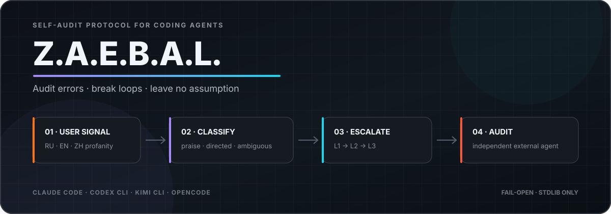

<div align="center">



<h3>
<strong>Z</strong>aebal? · <strong>A</strong>udit · <strong>E</strong>rrors ·
<strong>B</strong>reak · <strong>A</strong>nalyze · <strong>L</strong>eave no assumption
</h3>

<p>
<strong>其他语言版本</strong><br>
<a href="README.md">🇺🇸 English</a> ·
<a href="README.ru.md">🇷🇺 Русский</a> ·
<a href="README.zh-CN.md">🇨🇳 简体中文</a>
</p>

<p>


</p>

<p>
<strong>由用户粗口与直接抱怨触发的编程智能体自审计。</strong><br>
Z.A.E.B.A.L. 把用户的明显不满视为操作信号：停止当前路线、重新检查智能体的
基本假设，并在错误反复出现时把会话交给独立审计智能体。
</p>

<p>
<a href="#功能地图">功能</a> ·
<a href="#工作原理">工作原理</a> ·
<a href="#安装">安装</a> ·
<a href="#配置">配置</a> ·
<a href="#架构">架构</a>
</p>

</div>

---

## 为什么需要它

当编程智能体陷入循环时，它往往会用细微变体重复同一个动作。问题通常不是
“不够仔细”，而是它对任务或代码库持有一个错误假设，并继续把这个假设当作事实。
因此，再做一次相同视角的自检，很可能只会复制原来的错误。

Z.A.E.B.A.L. 在用户消息入口加入反馈闭环：

- 粗口和直接抱怨会成为审计信号；
- “fucking great” 这类带粗口的正面评价保持静默且不会增加连续权重，但不算确认，
  也不会解除 L3 或 L4 的修改暂停；
- 信号反复出现时，协议会逐级升级，最终要求完全停止；
- 在 L3，hook 会尝试启动技术上只读的外部审计；
- 在 L3 和 L4，只有用户明确确认后才恢复修改操作；
- 在 L4，必须先获准启动具体的 Swarm Review 团队（5–7 个子智能体）。

审计用于质疑智能体的理解，不会固定任务契约。它要求寻找能推翻解释的证据、
指出下一步具体改变，并检查用户实际遇到的问题。即使没有新的粗口或计数已重置、
过期，症状重现时也应检查上一次审计。允许继续不等于证明问题已修复。
参见[匿名化恢复案例](skills/zaebal/references/recovery-examples.md)。

当前版本不安装技术性工具锁。协议通过上下文要求智能体停止，最终控制权始终
留在用户手中。

### Mutation lock 可行性

2026-07-31 的调研表明，四个适配器都能在技术上阻断修改，但保证程度不同：

| 宿主 | 阻断机制 | 结论与限制 |
|---|---|---|
| Claude Code | [`PreToolUse`](https://code.claude.com/docs/en/hooks) 可拒绝 `Bash`、编辑/写入工具和 MCP 调用。 | **可行。** 退出码 `2` 或 structured `deny` 会在执行前阻断；hook 配置仍由宿主/用户控制。 |
| Codex | [`PreToolUse`](https://learn.chatgpt.com/docs/hooks.md) 可拒绝 Bash、`apply_patch`、MCP 和本地函数工具。 | **可行，覆盖较广。** 工具覆盖仍有例外，因此它是 guardrail，不是绝对 sandbox。 |
| Kimi CLI | [`PreToolUse`](https://www.kimi.com/code/docs/en/kimi-code-cli/customization/hooks.html) 可通过退出码 `2` 或 structured `deny` 阻断。 | **可行，但 fail-open。** hook 报错、崩溃或超时会放行操作。 |
| OpenCode | [`tool.execute.before`](https://opencode.ai/docs/plugins/) 可拒绝工具调用；[`permission`](https://opencode.ai/docs/permissions/) 可禁止编辑与 shell。 | **可行。** 持久锁应结合协议状态与宿主 permissions，而不只依赖 plugin 异常。 |

暂不加入锁或 state machine；先由文本修复和事件日志证明基于纪律的 STOP 是否仍然不足。

## 功能地图

| 功能 | 行为 | 实现 |
|---|---|---|
| 多语言检测 | 检测俄语、英语和中文粗口，包括标点拆分与常见字符替换。 | `core/wordlists/{ru,en,zh}.txt` + NFKC 标准化 |
| 意图分类 | 在修改连续触发状态前，区分正面评价、定向抱怨与不明确的情绪表达。 | `classify()`；权重 `0`、`1.0`、`0.5` |
| 会话级升级 | 在 30 分钟滑动窗口内按会话记录信号，并选择 L1–L4。 | 原子 JSON 状态 + 原生 `fcntl` / `msvcrt` 锁 |
| 四层审计协议 | 独立检查、假设清单、完全停止，以及须获同意的 swarm 提案。 | `core/protocol/L1.md` → `L4.md` |
| 会话优先证据 | 要求按时间顺序阅读会话、定位首次偏离，并与 diff 和带时间戳的提交对应：L1–L3 由工作智能体和两个内部审计智能体执行，L4 由获准的团队执行。 | 路径在最前；无源文件时才附带有界摘录 |
| 外部审计智能体 | 使用同厂商或跨厂商 CLI 检查会话源、定位摘录与仓库证据。 | Claude、Codex、Kimi 或 OpenCode |
| 四个宿主适配器 | 在 Claude Code、Codex CLI、Kimi CLI 与 OpenCode 提交用户消息时触发。 | JSON hooks、TOML hook 或 TypeScript plugin |
| 明确继续机制 | `continue`、`продолжай` 或 `по плану` 重置情绪计数并允许继续，但不证明问题已解决。 | 每个会话独立的状态 |
| 元数据事件日志 | 记录 trigger、auditor、verdict 与 ack，不保存消息内容。 | `~/.zaebal/incidents.jsonl` |
| Fail-open 安全 | 错误不阻断宿主会话。状态或日志写入失败会明确提示；未保存的触发不生成撤销令牌。 | 退出码 `0`；已检测的写入和审计错误进入上下文 |

## 工作原理

```text
用户消息
    │
    ▼
宿主适配器
UserPromptSubmit / chat.message
    │
    ▼
core/zaebal.py
normalize → detect → classify
    │
    ├─ clean / praise ──────────────────────────────► 静默 / 已开启时注入 Early Review 提醒
    │
    └─ directed (+1.0) / ambiguous (+0.5)
                         │
                         ▼
                    会话连续状态
                         │
              ┌──────────┼──────────┬──────────┐
              ▼          ▼          ▼          ▼
             L1         L2         L3         L4
              │          │          │          └─ 同意 → 5–7 名审查者
              │          │          ├─ 外部审计智能体
              └──────────┴──────────┴─ 协议注入上下文
```

### 升级级别

| 级别 | 连续权重 | 智能体行为 | 外部审计 |
|---|---:|---|---|
| **L1** | `0.5–1.5` | 阅读会话历史、定位首次偏离、执行两次独立内部审计并准备微型计划。 | 可选 |
| **L2** | `2–3.5` | 重读会话时间线，启动两个新的内部审计，复核上次结论，并与原始需求逐项比较。 | 默认关闭 |
| **L3** | `4–7.5` | 停止所有非审计工作；执行两个内部审计及配置的外部审计，把完整触发序列与 Git 时间线对应，并等待确认。 | 默认尝试；不安全的内置审计器会被拒绝 |
| **L4 — Swarm Review** | `8+` 或 `zaebal swarm` | 主动提议 swarm，询问 effort 和 5–7 名审查者的团队配置并请求启动同意；分析完整 diff、近期项目会话、抱怨、代码/runtime、设计、软件及修复/重构方案。 | 无论 `audit_levels` 如何设置，均不自动启动 |

定向抱怨增加 `1.0`，没有检测到对象的粗口增加 `0.5`。窗口为 30 分钟。普通问题
不会重置状态；正面评价也不会重置，只有明确同意继续才会重置。

## 安装

要求：

- `python3`；核心只使用 Python 标准库；
- 如果启用外部审计，至少需要一个受支持的智能体 CLI。

在仓库根目录运行：

```bash
chmod +x install.sh
./install.sh
```

安装器会检测可用宿主，把核心复制到 `~/.zaebal/`，并只更新对应的用户配置：

| 宿主 | 集成方式 | 默认审计命令 |
|---|---|---|
| Claude Code | `~/.claude/settings.json` 中的 `UserPromptSubmit` | `claude -p`，仅允许 `Read,Grep,Glob` |
| Codex CLI | `~/.codex/hooks.json` 中的 `UserPromptSubmit` | `codex exec --sandbox read-only` |
| Kimi CLI | 设置时位于 `$KIMI_CODE_HOME/config.toml`，否则位于 `~/.kimi-code/config.toml` | `kimi -p`（unsafe opt-in） |
| OpenCode | `~/.config/opencode/plugins/zaebal.ts` plugin | `opencode run`（unsafe opt-in） |

安装过程可重复执行：旧的 Z.A.E.B.A.L. hook 会被替换，其他设置以及
`~/.zaebal/config.json` 会保留。安装后请重启当前智能体会话。

## 验证

直接运行核心，并使用临时状态目录：

```bash
echo '{"session_id":"demo","prompt":"你这个傻逼又弄坏了"}' \
  | ZAEBAL_STATE_DIR="$(mktemp -d)" python3 core/zaebal.py --host kimi
```

输出应包含 `<zaebal level="1">`。

正面评价应保持静默：

```bash
echo '{"session_id":"demo-praise","prompt":"this is fucking great"}' \
  | ZAEBAL_STATE_DIR="$(mktemp -d)" python3 core/zaebal.py --host kimi
```

要验证 Kimi 确实消费了 hook（而不只是接受 TOML），并避免访问模型后端，请运行：

```bash
scripts/kimi-host-canary.sh
```

该 canary 使用隔离的 `KIMI_CODE_HOME`，发送真实的 content-part prompt，
并在 `UserPromptSubmit` 阶段阻止 turn。安装时若设置了 `KIMI_CODE_HOME`，
安装器会创建并使用该目录，而不是 `~/.kimi-code`。

## 配置

在智能体聊天中输入 `zaebal` 即可查看设置。安装请求、GitHub 链接和技能名称的
讨论不会启动审计。Claude Code、Codex、Kimi CLI 和 OpenCode 使用同一个核心：

| 聊天命令 | 操作 |
|---|---|
| `zaebal` / `zaebal config` | 显示设置，不启动审计 |
| `zaebal auto off` / `zaebal auto on` | 关闭 / 开启自动粗口触发 |
| `zaebal manual off` / `zaebal manual on` | 关闭 / 开启显式手动审计 |
| `zaebal early off` / `zaebal early on` | 关闭 / 开启工作过程中的 Early Review |
| `zaebal off` / `zaebal on` | 关闭 / 开启全部三种检查模式 |
| `zaebal audit` | 执行一次手动审计，不增加粗口连续触发权重 |
| `zaebal swarm` | 请求 L4 Swarm Review 提案；明确同意前不启动团队 |

全部检查模式关闭后，设置仍可访问。单独的俄语 `заебал` 仍可能是抱怨；管理时请使用
拉丁字母 `zaebal`。原生技能入口采用相同路由：
[Claude Code](https://code.claude.com/docs/en/skills) `/zaebal`、
[Codex](https://learn.chatgpt.com/docs/build-skills) `$zaebal`、
[Kimi](https://moonshotai.github.io/kimi-cli/en/customization/skills.html) `/skill:zaebal`；
在 [OpenCode](https://opencode.ai/docs/skills) 中请求智能体使用 `zaebal`。
没有活动 hook 时，技能使用 `python3 ~/.zaebal/core/zaebal.py --control status`，
或 `--control auto off` / `--control manual off` / `--control early on`。安装器也会将技能复制到
`~/.kimi/skills/zaebal/`，避免其他通用技能目录使 Kimi 忽略它。

到达 L4 时，智能体会主动提议 **[Swarm Review](skills/zaebal/references/swarm-review.md)**，
无需用户输入命令。先询问选择哪种受支持的推理 effort 和团队配置（5–7 名审查者及其角色，
支持时也提供模型/厂商选项），说明取舍和资源预算，并请求明确的启动同意。
MAX 是可选项，不会自动设置；仅选择配置不代表同意启动。使用用户选择的 effort 和团队，
并发槽位不足时分批执行，如实报告限制。团队综合原因、覆盖缺口与具体修复/重构方案；团队启动的
同意本身不授权任意修改、测试或部署。一次有界审查不会因每次触发而自动重启；命令
本身或连续状态重置都不能替代启动同意。

**Early Review** 默认关闭。开启后，hook 提醒智能体在首次实质结果或修改后、方法或目标
改变时，以及昂贵或不可逆操作前，静默调用只读命令 `--early-review`。
智能体核对请求、实际 diff/选项和原有正常行为；没有实质问题或需要用户决定的
事项时，不单独报告。细小修改应合并检查，不重复检查没有变化的证据。
该模式不增加粗口连续触发权重，不自动启动审计器，也不解除 STOP 或测试/访问限制。
它是给智能体的指令，不是逐工具的技术锁或后台进程。

默认值位于 [`core/config.json`](core/config.json)。用户覆盖配置位于
`~/.zaebal/config.json`，所有宿主共享，在下一条消息时自动加载：

```json
{
  "auto_trigger": true,
  "manual_trigger": true,
  "early_review": false,
  "auditor": "same",
  "audit_levels": [3],
  "auditor_timeout_sec": 90,
  "auditor_command": "",
  "allow_unsafe_auditor": false,
  "transcript_tail_chars": 12000,
  "agent_context_tail_chars": 2500
}
```

| 键 | 默认值 | 含义 |
|---|---|---|
| `auto_trigger` | `true` | 自动粗口检测及技能隐式启动的事件审计。 |
| `manual_trigger` | `true` | `zaebal audit` 和 `zaebal swarm` 同意提案。关闭后仍可查看设置。 |
| `early_review` | `false` | 工作过程中的静默检查，独立于抱怨和手动触发。使用 `zaebal early on` 开启。 |
| `auditor` | `"same"` | 与宿主相同的厂商、指定 `kimi` / `claude` / `codex` / `opencode`，或 `"none"`。内置 Kimi/OpenCode 审计在未显式启用 unsafe 模式时会明确降级。 |
| `audit_levels` | `[3]` | L1–L3 中同步调用外部审计器的级别；`[2, 3]` 可更早审计。L4 始终先请求启动同意。 |
| `auditor_timeout_sec` | `90` | 等待审计结果的最长秒数。 |
| `auditor_command` | `""` | 自定义命令；审计 prompt 会作为最后一个参数加入。 |
| `allow_unsafe_auditor` | `false` | 允许没有强制只读模式的内置 Kimi/OpenCode 审计器。优先使用 Claude/Codex 或 sandboxed `auditor_command`。 |
| `transcript_tail_chars` | `12000` | 发送给审计器的最大定位摘录；可读取的会话文件路径仍是权威历史。 |
| `agent_context_tail_chars` | `2500` | 无可读会话文件时的摘录上限；有源文件时，先注入路径，智能体直接读取源文件。 |

示例：让 Claude 审计 Codex 会话。

```json
{
  "auditor": "claude"
}
```

## 架构

```text
zaebal/
├── core/
│   ├── zaebal.py          # 检测、状态、升级、会话记录与审计器
│   ├── config.json        # 默认运行时配置
│   ├── protocol/          # L1.md–L4.md、early-review.md
│   └── wordlists/         # ru.txt、en.txt、zh.txt
├── adapters/
│   ├── claude-code/       # JSON hook 示例
│   ├── codex/             # JSON hook 示例
│   ├── kimi-cli/          # TOML hook 区块
│   └── opencode/          # chat.message plugin
├── skills/zaebal/         # 面向智能体的协议与配置参考
├── tests/                 # unit 与 end-to-end 合约测试
├── install.sh             # 可重复执行的宿主集成
└── uninstall.sh           # 移除 hook 并备份配置
```

Python 核心是运行时行为的唯一来源。宿主适配器只负责把各自事件转换为统一 JSON
合约，并把非空 stdout 注入回智能体上下文。

运行时状态位于 `~/.zaebal/`：

```text
~/.zaebal/
├── core/          # 已安装的核心副本
├── config.json    # 可选用户覆盖配置
├── state.json     # 按会话保存的加权触发历史
├── incidents.jsonl # 不含消息内容的 trigger/ack 事件
├── transcripts/opencode/ # OpenCode 审计使用的私有文本快照
└── state.lock     # 并发 hook 使用的原生锁
```

审计子进程会收到 `ZAEBAL_INTERNAL=1`，因此全局 hook 不会被审计 prompt 中引用的
用户粗口再次触发。

## 测试

```bash
cd tests
python3 -m unittest test_zaebal -v
```

测试覆盖标准化、RU/EN/ZH 检测、元信息误报、正面评价、加权升级、并发状态写入、
遥测、可移植安装路径、用户确认、防递归、审计器 sandbox 参数、失败处理，以及
端到端协议注入。

## 已知限制

- 检测器采用启发式规则；讽刺和特殊上下文仍可能造成误报或漏报。
- 检测器不会识别不含粗口的动作循环；通用 loop detector 是另一个产品，并有自己
  的误报模型。
- 原生 Windows 主机集成目前仅验证了 Codex；其他主机的适配器需单独验证。
  状态锁使用原生 `fcntl` / `msvcrt`。
- 内置 Kimi 与 OpenCode 审计器没有强制只读模式，因此默认拒绝运行；
  `allow_unsafe_auditor: true` 是显式 unsafe opt-in。
- 检测到触发时，OpenCode 适配器会把会话消息以 `0600` 权限保存到
  `~/.zaebal/transcripts/opencode/`，直到卸载或手动清理。
- 外部审计是同步的；在启用的级别上，用户需要等待审计结果或超时。

## 卸载

```bash
./uninstall.sh
```

该命令会移除 hooks、OpenCode plugin、已安装 skills 和 `~/.zaebal/`。如果存在
用户配置，会先备份到 `~/zaebal-config.backup.json`。
